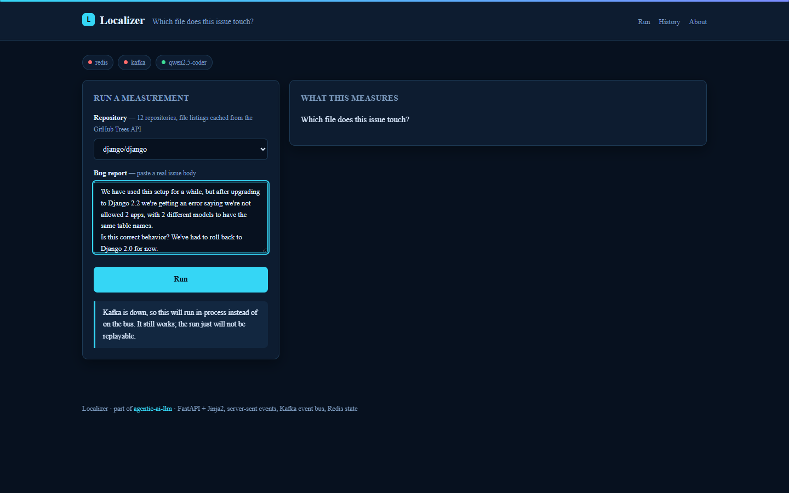
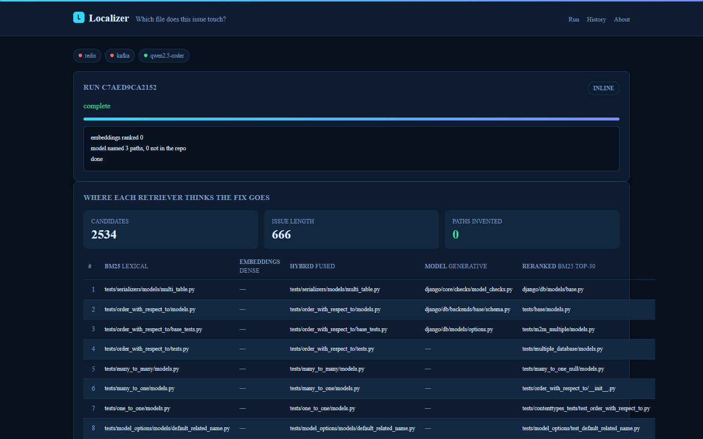
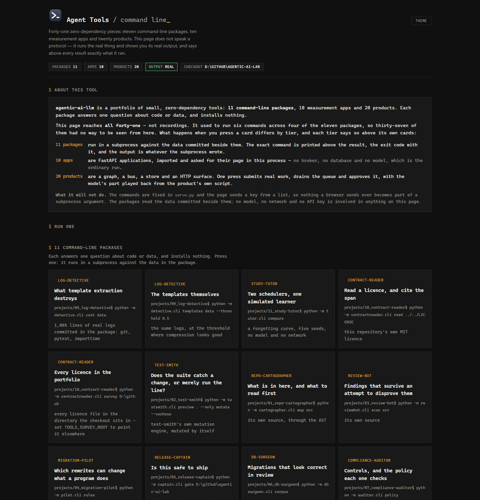
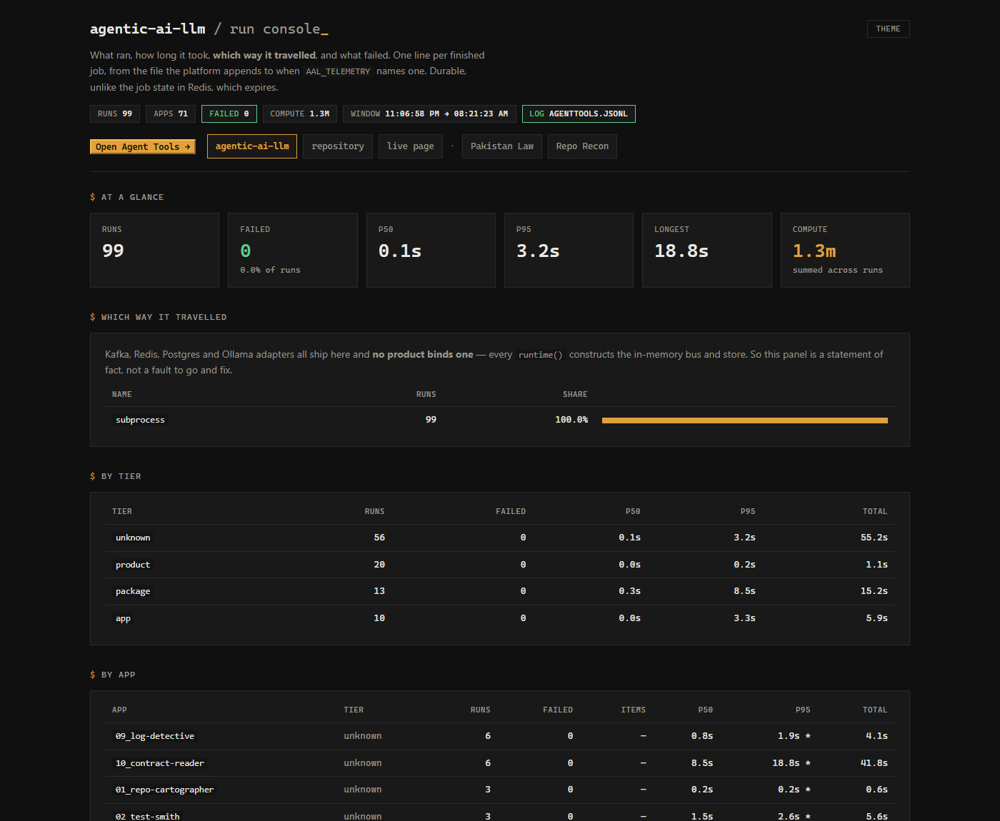

# agentic-ai-llm


We built agentic-ai-llm, a monorepo of three things for people who build with local coder
models: **ten measurement apps** that each answer one question changing what you would build
(does the bigger model earn its VRAM, when to stop a retry loop, do generated tests catch
anything, how much of a score is the prompt), **eleven zero-dependency developer tools**, and
**twenty multi-agent business products** on a shared ports-and-adapters platform. The apps are
real web applications on a Kafka job bus, Redis state and a worker that owns the one GPU; the
tools and products run with no model at all.

## Projects

**The ten measurement apps** ([`apps/`](apps), ports 8001-8010):

| # | App | Question |
|---|---|---|
| [**01**](apps/01_localizer) | [**Localizer**](apps/01_localizer) | which file does this issue touch? |
| [**02**](apps/02_false_accepts) | [**False Accepts**](apps/02_false_accepts) | how much wrong code do three asserts let through? |
| [**03**](apps/03_vuln_baseline) | [**Vuln Baseline**](apps/03_vuln_baseline) | can a model beat answering "safe" every time? |
| [**04**](apps/04_size_curve) | [**Size Curve**](apps/04_size_curve) | where does a 5× bigger model actually pay? |
| [**05**](apps/05_debug_ceiling) | [**Debug Ceiling**](apps/05_debug_ceiling) | how many rounds of self-debugging are worth it? |
| [**06**](apps/06_kill_rate) | [**Kill Rate**](apps/06_kill_rate) | do model-written tests catch anything? |
| [**07**](apps/07_repair_rewrite) | [**Repair or Rewrite**](apps/07_repair_rewrite) | patch the failure, or start over? |
| [**08**](apps/08_prompt_shapes) | [**Prompt Shapes**](apps/08_prompt_shapes) | how much of a score is the wording? |
| [**09**](apps/09_temperature) | [**Temperature Lab**](apps/09_temperature) | where do pass@1 and pass@k diverge? |
| [**10**](apps/10_roundtrip) | [**Roundtrip**](apps/10_roundtrip) | what survives code → prose → code? |

**The eleven developer tools** ([`projects/`](projects)), zero runtime dependencies and zero
LLM calls:

| # | Tool | What it does |
|---|---|---|
| [**01**](projects/01_repo-cartographer) | [**repo-cartographer**](projects/01_repo-cartographer) | Map an unfamiliar Python codebase from its AST, no embeddings, no model |
| [**02**](projects/02_test-smith) | [**test-smith**](projects/02_test-smith) | Mutation testing from the standard library: does the suite catch the change, or merely run it? |
| [**03**](projects/03_review-bot) | [**review-bot**](projects/03_review-bot) | Propose findings, then try to disprove each one; report only what survives |
| [**04**](projects/04_migration-pilot) | [**migration-pilot**](projects/04_migration-pilot) | Modernise Python where the rewrite is provably equivalent, and refuse where it would change behaviour |
| [**05**](projects/05_release-captain) | [**release-captain**](projects/05_release-captain) | Release readiness scored from diff statistics, not from opinion |
| [**06**](projects/06_db-surgeon) | [**db-surgeon**](projects/06_db-surgeon) | Prove a migration's rollback on a throwaway copy before trusting it |
| [**07**](projects/07_compliance-auditor) | [**compliance-auditor**](projects/07_compliance-auditor) | Stated policy checked against collected evidence; no inferred compliance |
| [**08**](projects/08_csv-analyst) | [**csv-analyst**](projects/08_csv-analyst) | Profile a CSV, compute only what validates, never narrate a number that was not computed |
| [**09**](projects/09_log-detective) | [**log-detective**](projects/09_log-detective) | Extract log templates, and report what the extraction destroyed |
| [**10**](projects/10_contract-reader) | [**contract-reader**](projects/10_contract-reader) | Read a licence, and cite the character span behind every claim |
| [**11**](projects/11_study-tutor) | [**study-tutor**](projects/11_study-tutor) | Spaced repetition where the scheduler is arithmetic and the model only writes questions |

**The twenty business agents** ([`products/`](products); every finding is in
[`products/README.md`](products/README.md)):

| # | Agent | # | Agent |
|---|---|---|---|
| [**01**](products/01_revenue-desk) | [**revenue-desk**](products/01_revenue-desk) | [**11**](products/11_watchtower) | [**watchtower**](products/11_watchtower) |
| [**02**](products/02_ward-sync) | [**ward-sync**](products/02_ward-sync) | [**12**](products/12_powerguard) | [**powerguard**](products/12_powerguard) |
| [**03**](products/03_one-desk) | [**one-desk**](products/03_one-desk) | [**13**](products/13_swarm-lab) | [**swarm-lab**](products/13_swarm-lab) |
| [**04**](products/04_ledger-brain) | [**ledger-brain**](products/04_ledger-brain) | [**14**](products/14_graph-clinic) | [**graph-clinic**](products/14_graph-clinic) |
| [**05**](products/05_comms-desk) | [**comms-desk**](products/05_comms-desk) | [**15**](products/15_claims-floor) | [**claims-floor**](products/15_claims-floor) |
| [**06**](products/06_oncall-mate) | [**oncall-mate**](products/06_oncall-mate) | [**16**](products/16_shelf-ops) | [**shelf-ops**](products/16_shelf-ops) |
| [**07**](products/07_hire-desk) | [**hire-desk**](products/07_hire-desk) | [**17**](products/17_fleet-desk) | [**fleet-desk**](products/17_fleet-desk) |
| [**08**](products/08_bid-desk) | [**bid-desk**](products/08_bid-desk) | [**18**](products/18_campus-ops) | [**campus-ops**](products/18_campus-ops) |
| [**09**](products/09_hermes-home) | [**hermes-home**](products/09_hermes-home) | [**19**](products/19_agri-desk) | [**agri-desk**](products/19_agri-desk) |
| [**10**](products/10_kyc-floor) | [**kyc-floor**](products/10_kyc-floor) | [**20**](products/20_driftwatch) | [**driftwatch**](products/20_driftwatch) |

## What it does

- **Each app is a web application**: FastAPI, Jinja2 and server-sent events, no JavaScript
  build step. Ten palettes, four light and six dark, drawn from
  **five** display/body typeface pairings and **nine** distinct corner radii,
  so two apps open side by side look different.
- **The web process never runs a measurement.** A submit publishes a job to Kafka
  (`jobs.requested`, partitioned by app); `worker.py` consumes it, calls Ollama with 8
  requests in flight and streams progress back over Redis pub/sub. `jobs.completed` is kept
  for a year, so every app's history page rebuilds its results from the log without
  re-running a generation.
- **One worker, one GPU.** Partitioning by app (`KAFKA_NUM_PARTITIONS: 10`) keeps a long sweep
  from starving a short one.
- **A shared Redis generation cache** keyed on `(model, prompt, temperature, seed)`: when two
  apps ask the same prompt, the second pays nothing.
- **LangGraph where the shape fits**: Debug Ceiling runs `generate → execute → repair →
  execute` as a state graph whose conditional edge reads a real assertion outcome.
- **Everything degrades.** With Kafka down a job runs in-process and the UI says so; with
  Redis down job state stays in that process. `tests/test_platform_degraded.py` submits a run
  with Redis, Kafka and the model all pointed at a closed port.
- **The products** run on a separate agent runtime (`products/platform`): a graph interpreter,
  a seven-node blueprint, an approval gate, write authority, admission control and gated
  memory, with a default model that refuses any prompt it was not given.
- **The run console** in [`observability/`](observability) reads what the apps recorded.

## Screenshots



Input: the Localizer app with the text of SWE-bench Lite issue `django__django-11630`
("Django throws error when different apps with different models have the same name table
name"), repository `django/django` picked from the cached file listings.



Output: 2,534 candidate files ranked five ways. BM25 and the hybrid ranking fill their top 10
with test models; the model naming files from its own knowledge puts the file the real fix
changed, `django/core/checks/model_checks.py`, first, and invents no path. The embeddings column
is empty because Ollama refused one of the embedding batches on this run, and the app shows the
arm as missing rather than ranking from a partial index. Run on the CPU with
`qwen2.5:7b-instruct` (`MODEL=qwen2.5:7b-instruct OLLAMA_NUM_GPU=0`), Kafka and Redis down, so
the job ran in-process; the numbers in "What they found" come from `qwen2.5-coder` runs.



Every piece of this repository from one page: the eleven command-line packages, the ten
measurement apps and the twenty products. A package runs in a subprocess, an app is
imported and asked for its page, and a product submits real work, drains the queue and
approves it - so what a press does differs by tier, and each tier says so above its own
cards.



The console behind it. The tier is recorded with each run rather than guessed from a
name, because sorting a product graph next to a package subprocess by duration compares
two things that are not comparable. Runs recorded before the tier existed read
`unknown`, which is the truth about them.

## Sample input / output

`log-detective` over the 1,005 lines of real logs committed in its package
(`cd projects/09_log-detective` then `python -m detective.cli cost data`), no model:

```
1,005 lines read, 973 scored (32 blank); every ratio below is over the scored count

 thresh  templates  compression  merged  distinct lost  singletons
    0.9        921         1.1x       0              0         908
    0.8        822         1.2x       6             99         804
    0.7        266         3.7x     104            655         150
    0.6        224         4.3x     108            697         105
    0.5        104         9.4x      22            817          72
    0.4         90        10.8x      24            831          57
    0.3         71        13.7x      26            850          37

  'distinct lost' counts messages that no longer have a template of
  their own. Compression is bought by deciding two lines are the same.
```

## What they found

Measured by the apps on `qwen2.5-coder` at 14B and 3B over MBPP, HumanEval, SWE-bench Lite and
Devign. The model runs needed a GPU and both model sizes, and their run artifacts are not
committed. The BM25 localization row needs neither and is reproducible from a fresh clone:

```bash
python -m apps._engine.localize_eval     # all 300 instances, ~30s, no model, no network
```

It reads the benchmark columns committed under [`data/benchmarks/`](data/benchmarks) (2.8
MB) and the tree listings in `data/trees`. The one instance whose gold file is absent from its
repository listing is kept in the denominator and scored as a miss, so the denominator is
154 and not 153.

- **BM25 collapses from 75% (38 of 51) to 8.4% (13 of 154)** depending only on whether the
  issue quotes the file path. The same 14B model scores 55.8% on that hard half when naming
  files freely and **17.5% when restricted to reranking**: its advantage is knowing the
  repository, not reading the issue. Its rate of naming files that do not exist is not quoted
  until that arm is re-run with the parser that reads bolded, quoted and line-numbered paths;
  `fabrication_rate` reports `lines_unparsed` beside the rate.
- **Devign's always-SAFE baseline is 54.1%**, against published accuracies around 62%: eight
  points of headroom, not sixty-two. The app samples the split with a seed and returns both
  constants; the model's figure is pending a re-run on that sample.
- **18.0% of 4,055 single-point mutants survive MBPP's three asserts**, and 362 of them are
  provably wrong (half the survivors; the rest are reported unproven rather than counted).
  Hand-verification does not fix it: the sanitized split scores 16.5%.
- **Self-debug rounds 1–2 captured 100% of the gain**; rounds 3–5 added zero tasks for 60% of
  the compute. Independently, **93.3% of first-attempt failures survive both** repair and
  rewrite.
- **The 3B already handles 75.8%** of everything either size can solve.
- **Generated tests beat the benchmark's own**: 93.4% kill rate against 85.0%, but only when
  written from the implementation. From the task description, just 16.0% even agree with the
  reference.
- **Describing the reference code and reimplementing from that beats MBPP's own description by 32.5 points.** That is a leak, not better documentation, and 32.5 is an upper bound on it: app 10's description-only baseline is the one place here that does not hand the model one of MBPP's own asserts, which is why app 04 reports the same 14B at 76.0% on the task description where app 10 reports 48.0%. A `direct_with_test` arm sits between them; the share of the 32.5 due to the assert rather than the leak is measured when it runs.

Root suite: **1,358 tests collected** by `pytest --collect-only`, run with no model, no Kafka
and no Redis; `scripts/test_all.py --fresh` runs every suite in the monorepo. Its
`--write-counts` mode sets `AAL_COUNTING_SWEEP`, which skips the **47** tests that read the
count fixture it is writing, so its line for this suite shows 47 more skips than a plain run.

## Tech stack

- Python 3.11+
- Apps: FastAPI, Uvicorn, Jinja2, `sse-starlette`, HTMX-style server-rendered pages
- Bus and state: Kafka via `aiokafka` (KRaft in `docker-compose.yml`), Redis via `redis`
- Orchestration: LangGraph (Debug Ceiling's repair loop)
- Models: Ollama over `httpx` (`qwen2.5-coder:14b` and `:3b`, `nomic-embed-text`)
- Data: pandas, pyarrow; benchmark columns committed as parquet/JSON
- Tools in `projects/`: standard library only; products in `products/`: their own platform package
- Dev: pytest, pytest-asyncio, fakeredis, ruff, uv; GitHub Actions

## Run it

```bash
git clone https://github.com/hammasbuilds/agentic-ai-llm
cd agentic-ai-llm
uv sync --all-groups
uv run pytest -q                     # root suite: no model, no Kafka, no Redis

docker compose up -d                 # redis + kafka (KRaft, no zookeeper)
uv run python worker.py              # consumes the bus; needs Ollama
sh serve_all.sh                      # ten apps on 8001-8010
```

- The apps need Ollama with `qwen2.5-coder:14b`, plus `:3b` for Size Curve and
  `nomic-embed-text` for Localizer. `MODEL` picks another model and `OLLAMA_NUM_GPU=0` keeps it
  on the CPU.
- One app without the stack:
  `uv run uvicorn app:app --app-dir apps/01_localizer --port 8001` (Kafka and Redis down means
  the job runs in-process).
- Each tool in `projects/` and each product in `products/` has its own README with its
  commands; [`RUNNING.md`](RUNNING.md) lists which tools ship a UI and how to start it.

## Licence

MIT, see [LICENSE](LICENSE). SWE-bench Lite, MBPP, HumanEval and Devign keep their own licences.
